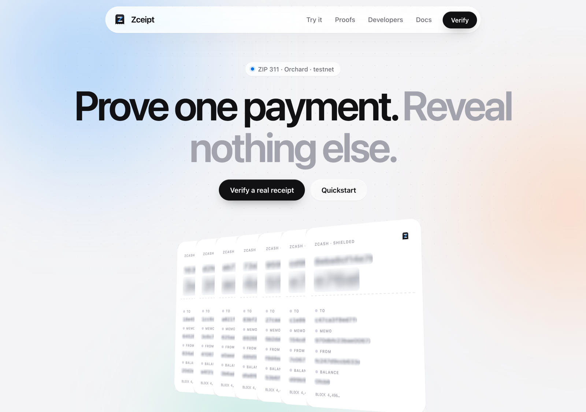
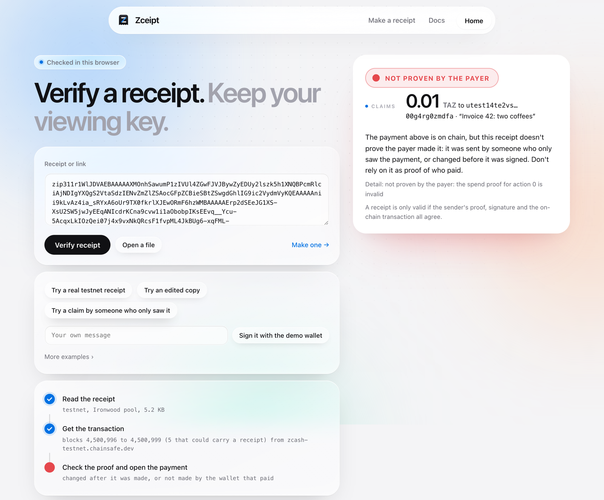
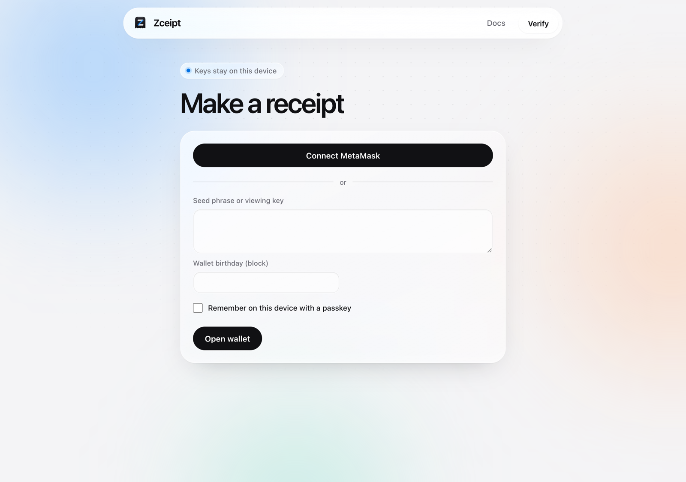

<picture>
  <source media="(prefers-color-scheme: dark)" srcset="site/brand/lockup-dark.svg">
  
</picture>

# Zceipt

**ZIP 311 for Orchard and Ironwood, extended so payments can be proven in relation to each other.**

Zceipt proves one Zcash payment without handing over a viewing key. It then goes further: it
proves facts about *sets* of payments (one payer, different payers, one wallet's accounts, a
delegated issuer, a total) without revealing the wallet's history.

| | |
|---|---|
| Demo video | [youtube.com/watch?v=UuaMckKC1rg](https://www.youtube.com/watch?v=UuaMckKC1rg) |
| Website | [zceipt.xyz](https://zceipt.xyz) |
| Docs | [zceipt.xyz/docs](https://zceipt.xyz/docs/) |
| Check a receipt | [zceipt.xyz/verify](https://zceipt.xyz/verify/) |
| Make a receipt from your wallet | [zceipt.xyz/verify/make](https://zceipt.xyz/verify/make) |
| MetaMask snap | [`zceipt-snap`](https://www.npmjs.com/package/zceipt-snap) on npm |
| Status and caveats | [zceipt.xyz/docs/status](https://zceipt.xyz/docs/status) |

## Demo

[](https://www.youtube.com/watch?v=UuaMckKC1rg)



## Contents

- [Demo](#demo)
- [The problem](#the-problem)
- [The solution](#the-solution)
- [The eight relationship proofs](#the-eight-relationship-proofs)
- [Supported pools](#supported-pools)
- [Try it](#try-it)
- [Make a receipt](#make-a-receipt)
- [Install the CLI](#install-the-cli)
- [SDKs](#sdks)
- [What a receipt proves](#what-a-receipt-proves)
- [Who learns what](#who-learns-what)
- [How we built it](#how-we-built-it)
- [Challenges we faced](#challenges-we-faced)
- [The forked circuits](#the-forked-circuits)
- [Audits and tests](#audits-and-tests)
- [Status](#status)
- [Who needs it](#who-needs-it)
- [For developers and reviewers](#for-developers-and-reviewers)
- [Repository layout](#repository-layout)
- [Related work](#related-work)

## The problem

A shielded Zcash payment hides the sender, the recipient and the amount. That is the point, and
it is also why nobody can prove a payment afterwards without giving up far more than the payment.

- **The only tool is the viewing key, and it shows everything.** Asked to prove one payment, a
  user hands over a key that opens every payment the wallet ever made or will make.
- **There is no standard receipt.** The Sprout-era payment disclosure was deprecated and nothing
  replaced it ([zcash#2036](https://github.com/zcash/zcash/issues/2036),
  [zips#387](https://github.com/zcash/zips/issues/387)). ZIP 311 specifies one for Sapling, and
  for Orchard it says `TODO`.
- **Showing a payment isn't proving you made it.** An output disclosure can be produced by anyone
  who saw the payment, such as the recipient or anyone they forwarded it to
  ([zcash#737](https://github.com/zcash/zcash/issues/737)). It proves the money moved, not who
  moved it.
- **Real money gets stuck.** In July 2026 a user's $589K from a shielded ZEC swap was held for
  50+ days. They offered to "sign a verification message", and there was no
  Zcash-native way to do it ([forum](https://forum.zcashcommunity.com/t/my-experience-exiting-shielded-zec-from-zodl-to-near-intents-589k-usdt-still-held-50-days-despite-a-written-compliance-clearance/57497)).
  Binance's threatened delisting over shielded deposits, the largest forum thread we found, was
  about the same gap ([forum](https://forum.zcashcommunity.com/t/important-potential-binance-delisting/45954)).
- **One payment is rarely the question.** A grant round wants to know that 40 donors are 40
  wallets, not one wallet 40 times. An auditor wants to know that one key made all of these
  payments, or that a treasury's 2-of-3 policy signed this one. A lender wants a total, not a
  ledger. Today each of those means a viewing key.

We read the forum (83 posts), 92 GitHub issues across 15 Zcash repositories, X, Hacker News and
how seven other chains handle the same problems; the full list, each pain with its source and what Zceipt
does about it, is [PAIN-POINTS.md](docs/PAIN-POINTS.md).

## The solution

Zceipt is a receipt the payer makes for one payment, and a family of proofs about how payments
relate to each other. Each one reveals exactly what it states.

| | Proves | Can be made by |
|---|---|---|
| A viewing key | Every payment, past and future | Anyone holding it |
| Output disclosure (zreceipt, the ZIP 311 output draft) | Who was paid and how much | Anyone who saw the payment |
| **A Zceipt receipt** | Who was paid, how much, the memo, **and that the payer's key made the payment** | Only the payer |
| **Zceipt relationship proofs** | One key made all of these; these are different wallets; these accounts are one wallet; an agent issued this within a policy; at least X was received | Only the parties involved |


### Spend authority

ZIP 311 calls a payment disclosure complete only with a proof that the payer's spend authority
made the payment. For Orchard it says `TODO`. Zceipt fills that in for Orchard and Ironwood:
a fresh Orchard Action proof for the note the payment spent, and a signature by the key that
spent it. Opening a receipt shows who was paid, how much and the memo, and that the payer made it.
Change one character and it fails.

Output disclosure alone (what [zreceipt](docs/RELATED-WORK.md) and the ZIP 311 output-disclosure
draft do) can be made by anyone who saw the payment. The verifier page shows the difference:
the same payment claimed with another key reads **NOT PROVEN BY THE PAYER**.

More: [spend authority](https://zceipt.xyz/docs/concepts/spend-authority),
[what a receipt reveals](https://zceipt.xyz/docs/concepts/what-a-receipt-reveals).

### How a receipt is made

1. The wallet finds the payment's transaction and the note it spent, by scanning from its
   birthday the way a light wallet syncs.
2. For each output to show, it includes the output's `ock`, which opens that output and no other.
3. For the spent note, it makes a fresh Orchard Action proof: same note, same anchor, same
   nullifier as on chain, under a fresh randomized key `rk`.
4. It signs the whole receipt (outputs, message, proofs) with `rk`. Only the holder of the
   spending key can, and with `create --unsigned` the proofs are made from the viewing key on one
   machine and signed on another.
5. A verifier fetches the transaction by txid, opens the shown outputs, checks the proof against
   the chain's anchor and nullifier, and checks the signature. One changed byte and it fails.

The wire format is in [SPEC.md](docs/SPEC.md); every gap in ZIP 311 and the protocol spec that
this had to resolve is in [SPEC-AMBIGUITIES.md](docs/SPEC-AMBIGUITIES.md).

## The eight relationship proofs

On top of spend authority, each of these states one relationship and reveals nothing else about
the wallet:

| Question | Proof | Text prefix | Docs |
|---|---|---|---|
| Did one key make all of these payments? | Same-payer proof | `zip311b1`, `zip311k1` | [same payer](https://zceipt.xyz/docs/composability/same-payer) |
| Did N different wallets pay, not one wallet N times? | Payer tags, claim tags | `zip311t1` | [distinct payers](https://zceipt.xyz/docs/composability/distinct-payers) |
| Are these two payers accounts of one wallet? | Sibling-account proof | `zip311w1` | [sibling accounts](https://zceipt.xyz/docs/composability/sibling-accounts) |
| Was it signed by one of a department's keys? | Key-set proof | `zip311m1` | [key sets](https://zceipt.xyz/docs/composability/key-sets) |
| Can a back office issue receipts without my spend key? | Delegation | `zip311a1`, `zip311g1` | [delegation](https://zceipt.xyz/docs/composability/delegation) |
| Did I receive at least X across payments, from k payers? | Income proof | `zip311i1` | [income](https://zceipt.xyz/docs/composability/income) |
| Was it authorized by this 2-of-3 treasury? | FROST policy proof | `zip311p1` | [FROST policy](https://zceipt.xyz/docs/composability/frost-policy) |
| Did the money come from this vetted set? | Source and screened-set proofs | `zip311s1` | [source of funds](https://zceipt.xyz/docs/composability/source-of-funds) |

Alongside them: the base receipt (`zip311r1`), the Sapling receipt (`zip311z1`) and a receipt
only one named verifier can check (`zip311d1`). Every proof type has run on the Zcash public
testnet; the real proofs are in [examples/testnet/proofs](examples/testnet/proofs).

The design, in order, with why each piece is needed: [TECHNICAL-NOTE.md](TECHNICAL-NOTE.md)
([on the site](https://zceipt.xyz/docs/reference/technical-note)).

## Supported pools

| Pool | Receipt | Relationship proofs | Evidence |
|---|---|---|---|
| **Orchard** | `zip311r1`: fresh Action proof plus spend signature | all eight | real testnet payments, regtest |
| **Ironwood** (NU6.3, NU7 in librustzcash) | `zip311r1`, same construction | all eight | Ironwood outputs opened on testnet transactions, regtest, cross-pool regtest |
| **Sapling** | `zip311z1`, as the ZIP 311 draft specifies: output disclosure by `ock`, a fresh Spend proof and signature per spend | none | a real testnet payment's receipt verified against the chain ([examples/testnet-sapling](examples/testnet-sapling)) |
| Transparent | out of scope | | |

Ironwood is not in a librustzcash release yet, so eight crates are pinned to a git revision.

## Try it

**In the browser, nothing to install:** open [zceipt.xyz/verify](https://zceipt.xyz/verify/) and
click **Try a real testnet receipt**. A real 0.01 TAZ payment
([`571de6e4…`](https://testnet.cipherscan.app/tx/571de6e4cc96b64c0d849cc172905449011b195e521532d78fe9c29a149e0e73))
opens as the merchant it paid and shows **PAID TO YOU**; opened without your address, a receipt
shows **VERIFIED · RECIPIENT NOT CHECKED**. **Try an edited copy** shows the same receipt with its
signed message changed from "Order #42" to "Order #43": **NOT VALID**. **Try a claim by someone
who only saw it** shows **NOT PROVEN BY THE PAYER**, which is what an output-only disclosure can't
tell apart. Type a message and **Sign it with the demo wallet**: it signs a real testnet payment from a public demo
wallet ([`examples/testnet/demo`](examples/testnet/demo)) for whatever you type, in the browser,
then verifies it. The first check loads the verifier (3 to 10 seconds).


<p>
</p>

**The same page locally:**

```bash
./scripts/serve-verifier.sh        # then open http://127.0.0.1:5321
```

**From the terminal:** `zceipt demo` verifies a real testnet receipt and refuses an edited copy;
`zceipt demo -m "…"` prints one with your message to check with `zceipt verify`;
`zceipt demo --shop` runs the payment API flow in the sandbox and leaves the API, dashboard and
verifier running.

## Make a receipt

**In the browser:** [zceipt.xyz/verify/make](https://zceipt.xyz/verify/make). Open your wallet
with its seed phrase or its viewing key and its birthday. The page reads the chain the way a light
wallet syncs, lists the payments the wallet sent as it finds them, and you tap one. It makes the
proofs in your browser (about half a minute), shows the outputs it will reveal and lets you untick
any before proving, then signs; with a viewing key it asks for the seed
phrase at the end, or saves the prepared receipt for another signer. The phrase and the key stay
in the page's memory; nothing leaves the device but block requests. The page can remember the
wallet on that device behind a passkey (WebAuthn PRF).



**With MetaMask:** the [`zceipt-snap`](https://www.npmjs.com/package/zceipt-snap) snap
([source](packages/zceipt-snap)) holds the wallet inside MetaMask, gives the make page a viewing
key, and signs each receipt the page has made, so the page never sees a seed. On the
make page choose **Connect MetaMask**. It needs [MetaMask Flask](https://docs.metamask.io/snaps/get-started/install-flask/),
since the snap is not on MetaMask's allowlist, and it only answers zceipt.xyz and localhost.

**In a wallet app:** wallets on the Zcash Android or iOS SDK add the button with two calls from
the Swift/Kotlin bindings, `prepareReceipt(dbPath, …)` and `signPrepared(…)`
([crates/zceipt-ffi](crates/zceipt-ffi), [guide](docs/guides/wallet-integration.md)).

**In a terminal**, the CLI finds your notes by scanning the chain from the wallet's birthday:

| You have | Command |
|---|---|
| A viewing key (any wallet exports one) | `zceipt create --ufvk @key.txt --birthday <height> --txid <txid> --unsigned r.txt`: the proofs, with no spending key |
| Then, on a machine that holds the seed (offline is fine) | `zceipt sign r.txt --seed-stdin`: lists the spends it signs, by action index, and asks before signing |
| Or the seed phrase on one machine | `zceipt create --seed-stdin --network main --birthday <height> --txid <txid>` |
| A zcash-devtool wallet | `zceipt create -w <wallet> -i <key.age> --txid <txid>` |
| A Sapling payment from a zcash-devtool wallet | `zceipt create-sapling -w <wallet> -i <key.age> --txid <txid>` |

The seed phrase is typed (not shown) or piped in, never put on the command line.
`zceipt export` turns many receipts into a spreadsheet and keeps a record of each check for a
case file. Step by step: [from a wallet](https://zceipt.xyz/docs/use/wallet),
[from the terminal](https://zceipt.xyz/docs/use/terminal),
[checking a receipt](https://zceipt.xyz/docs/use/check).

## Install the CLI

Needs Rust ([rustup](https://rustup.rs)); `rust-toolchain.toml` pins the toolchain and rustup
installs it. The first build takes about ten minutes.

```bash
git clone https://github.com/danielAsaboro/zceipt && cd zceipt
./scripts/install.sh               # cargo install --locked --path crates/zceipt-cli, then zceipt demo
```

Or with Docker: `docker compose run --rm zceipt demo` (`docker compose up` runs the payment API on port 8723). Then:

```bash
zceipt doctor                      # checks servers, API key, clock and wallet, says what to fix
zceipt verify @examples/testnet/receipt.txt
```

| Command | What it does |
|---|---|
| `create`, `create-sapling`, `sign` | make a receipt for a payment you sent, optionally signing on another machine |
| `verify`, `inspect`, `export` | check against the chain, decode offline, verify many into a spreadsheet |
| `received`, `income`, `reserve` | prove you received a payment, received at least an amount, or hold at least an amount |
| `claim`, `tag`, `siblings` | one claim per wallet, payer tags for counting different donors, sibling accounts |
| `key`, `delegate`, `verifier-key` | publish a key for a key set, delegate receipts to a session key, receipts for one verifier only |
| `shop` | the payment API for shops, exchanges and sites |

Full reference: [CLI](https://zceipt.xyz/docs/reference/cli), formats:
[formats](https://zceipt.xyz/docs/reference/formats).

## SDKs

| Language | Path | Client | Webhooks |
|---|---|---|---|
| TypeScript / JS | [packages/zceipt](packages/zceipt) | `new Zceipt(key, { baseUrl })` from `zceipt/client`; `verifyReceipt(link)` in the browser (WASM); `<zcash-receipt>` web component; React; `zceipt/middleware` for Express and fetch-style servers | `webhooks.constructEvent` |
| Python 3.9+ | [packages/zceipt-python](packages/zceipt-python) (standard library only) | `Zceipt(key, base_url=…)`; `zceipt.web` for FastAPI, Django, Flask | `construct_event` |
| Go | [packages/zceipt-go](packages/zceipt-go) (standard library only) | `zceipt.New(key)` | `zceipt.ConstructEvent` |
| Rust | [crates/zceipt-client](crates/zceipt-client) | `Client::new(key).base_url(…)` | `webhooks::construct_event` |
| Rust, in process | [crates/zceipt-core](crates/zceipt-core) | `zceipt_core::verify`, `ReceiptBuilder` | |
| Swift / Kotlin | [crates/zceipt-ffi](crates/zceipt-ffi) | `prepareReceipt`, `signPrepared` | |

The SDKs install from this repository; only the snap is on npm. The `<zcash-receipt>` component
and `verifyReceipt` must be served from your own origin (copy `web/zceipt/` next to your page):
they start a worker, and browsers refuse a worker script from another origin. The API clients share typed
errors with `code` and `param`, an automatic `Idempotency-Key` on every POST, retries on network
errors, 429 and 5xx, and cursor pagination. They talk to the payment API (`zceipt serve`,
[OpenAPI](docs/openapi.yaml)), which with webhooks and a dashboard sits around the same core but
is not part of the cryptographic contribution. More: [SDKS.md](docs/SDKS.md),
[QUICKSTART.md](docs/QUICKSTART.md), [FEATURES.md](docs/FEATURES.md),
[the HTTP 402 guide](docs/guides/http-402.md).

## What a receipt proves

| | Shown | How it is checked |
|---|---|---|
| Who was paid, how much, the memo | yes | Opened from the transaction on chain with a key that opens only that output |
| That it was signed by the key that spent the money | yes | A fresh zero-knowledge proof for the note the payment spent, and a signature over the whole receipt |
| A message (invoice number, a verifier's challenge) | yes | Signed with the receipt |
| The payer's address, balance, other payments | no | Never included |
| That the payment is on chain | on a chain server's word | `--cross-check <host:port>` asks a second server of your choice (it learns the txid) |

A link is about 7 KB; some chat apps cut long links, so the page also saves a receipt as a file
and opens one. The payer chooses which outputs to show, so a verifier checks the recipient it
expects (`--expect-address`, or the page's "Was it paid to you?"). Exact claim, assumptions and
limits: [CLAIM.md](docs/CLAIM.md).

## Who learns what

| Party | Learns | Doesn't learn |
|---|---|---|
| Whoever you give the receipt to | the shown outputs, your message, that you paid | your address (unless you choose to prove it), balance, other payments |
| The chain server, when someone verifies (by default ChainSafe's for the page, zec.rocks for the CLI, or yours) | the payment's block (or, if it is quiet, its run of 4 blocks) and up to 64 transactions in each; the verifier's IP | which of those transactions, or anything in the receipt |
| The chain server, when you make a receipt | the block range it scans from the wallet's birthday; then, as when someone verifies, the payment's run of 4 blocks and up to 64 transactions in each; one 1,000-block window per spent note, so how many notes the payment spent; from the make page, `Origin: https://zceipt.xyz` on every request, so that a Zceipt page (not a wallet app) is syncing | which note, payment or transaction |

In a quiet block the server can narrow it down, and the page and CLI say so. Full analysis:
[THREAT-MODEL.md](docs/THREAT-MODEL.md).

## How we built it

The git history tells it in order. Every step below is a commit you can read.

| Dates (2026) | What happened |
|---|---|
| Oct 14 | The core crate: ZIP 311 disclosures for Orchard and Ironwood. A CLI that makes receipts from a zcash-devtool wallet and verifies against lightwalletd. A browser verifier (Rust to WASM, gRPC-web to lightwalletd). Regtest end to end. Moved to librustzcash `main` for NU7 (Ironwood), then the first real testnet payment, receipt, and CLI and browser verification the same day. |
| Oct 15 | Wrote the spec verifier and the crypto review, which found the address-proof forgery (below). Exchange deposits across the ZIP 320 TEX two-step. Reorg handling, rate limits, batches verified in parallel (1.0 s for three testnet receipts), a smaller WASM. `doctor`. |
| Oct 16 | Source of funds (format v4), outputs without their memo (v5), incoming receipts, signed payment requests, proof of funds. Mutation testing and fuzzing of each new format. |
| Oct 21 to 23 | Deposit desks for exchanges. A judging pass: batches refuse an output counted twice, `--cross-check` against a second server, the `zip311r1` prefix so receipts can't be confused with other projects' links. Receipts from any wallet's seed or viewing key, watch-only receipts, `export`, screened-set proofs. Proved the base receipt builds on stock `orchard`. |
| Oct 24 | The composability day: same-payer proofs, FROST 2-of-3 treasury receipts, income and policy proofs, key sets, claim and payer tags on a forked Action circuit, one-verifier receipts, sibling-account proofs in a new Halo 2 circuit with a ported BLAKE2b gadget, delegation. |
| Oct 25 | Every proof type run on the public testnet (`scripts/e2e-testnet.sh`) and attacked there and offline; five weaknesses found and fixed. An audit tool for unconstrained circuit cells. A known-exploit pass. |
| Oct 26 to 27 | The hostile audit and its rerun, and every finding fixed. Renamed from Receipts to Zceipt and built zceipt.xyz. |
| Oct 28 | The privacy audit and its four fixes. The landing page, dashboard and verifier redesign. The browser make page, passkey unlock and the MetaMask snap. Sapling receipts, verified on a real testnet payment. |

## Challenges we faced

- **ZIP 311 leaves Orchard as `TODO`.** There was no spec to follow, so we wrote one: an Orchard
  spend disclosure is an Action proof spending the same note at the same anchor, with a
  zero-value dummy output, plus a `SpendAuthSig` by the fresh `rk`. The proposed ZIP text is
  [ZIP311-ORCHARD.md](docs/ZIP311-ORCHARD.md).
- **Our own forgery.** ZIP 304's trick for address proofs (spend a fake 1-zatoshi note) relies on
  the circuit enforcing the anchor only for non-zero values. Our first Orchard address proof took
  the value commitment from the prover, so a zero-value note skipped the anchor check and anyone
  could claim any address. Found on Oct 15 by reading ZIP 304's rationale against the Action
  circuit's `v_old · (root − anchor)` gate; the verifier now computes `ValueCommit_0(1)` itself, a
  receipt made before the fix is kept in the repo and refused, and tests check the attack.
- **Ironwood isn't released.** NU6.3 (NU7 in librustzcash) runs on testnet but isn't in a
  librustzcash release, so eight crates are pinned to a git revision.
- **The protocol spec can't open Ironwood outputs as written.** §4.20.3, which ZIP 311 cites,
  derives `rcm` the pre-Ironwood way; followed literally, every Ironwood output fails to open. The
  Python spec verifier found it, and both verifiers use `Derive_rcm` (A9 in
  [SPEC-AMBIGUITIES.md](docs/SPEC-AMBIGUITIES.md)).
- **The chain server learns things.** Recording the bytes sent to lightwalletd showed that
  rebuilding a witness told the server which block the spent note came from, and later that the
  scan range still ended at the payment's block. Both fixed: the wallet asks for whole
  1,000-block windows and reads to the end
  ([ASSURANCE.md §6](docs/ASSURANCE.md#6-what-the-chain-server-sees)).
- **`orchard` doesn't expose what we needed.** No way to load precomputed parameters, to reach
  a note's `esk` or commitment opening, or to reuse the Action constraints in another circuit.
  Rather than copy the circuit, we patched the published crate in the smallest way that works
  (next section) and kept the base receipt buildable on stock `orchard`.
- **Counting wallets without identifying them.** A tag per key and domain lets an organiser
  count distinct payers, but our first version gave one key the same tag in an airdrop and a
  donor round with the same name, linking claimants to donors. Found by attacking the testnet
  proofs; the domain is now hashed under a personalization per kind.
- **One wallet's accounts counted as different payers.** Proving that two tags come from one
  wallet needed BLAKE2b in a circuit (ZIP 32 derivation). We ported
  `eryxcoop/blake2b_halo2` from `midnight-proofs` to Zcash's `halo2_proofs` 0.4, which puts the
  circuit at `k = 17` and 32 seconds to prove.
- **A browser that must prove and verify.** Verifier warm-up was 7.7 s; precomputed parameters
  brought it to 2.9 s, and the verifier's WASM went from 2.4 MB to 2.2 MB (4.0 MB today, with the maker in the
  same module). The make page does the proofs in a worker in about half a minute.
- **Keeping the site honest about privacy.** The privacy audit found the landing page loading
  Three.js from a CDN (every visitor's IP to a third party) and an SDK putting a client secret in a
  URL. Three.js is now vendored, a strict CSP covers every path, and the secret moved to a header.
  The Mintlify docs then needed `'unsafe-eval'` on `/docs` only.

## The forked circuits

The base receipt uses the **stock** Orchard Action circuit and keys, unchanged:
`params_match_derivation` and every testnet receipt check this. Two proofs need circuit code
written here. Everything is in the open and diffable against the published crates.

### The `orchard` patch

[vendor/orchard](vendor/orchard) is `orchard` 0.16.0 from crates.io, unchanged except for
[orchard-0.16.0-zceipt.patch](vendor/orchard-0.16.0-zceipt.patch), wired in through
`[patch.crates-io]` and used only by `zceipt-core`'s `orchard-ext` feature:

| Change | File | Why |
|---|---|---|
| `VerifyingKey::build_with_unchecked_params`, `params_bytes` | `src/circuit.rs` | load precomputed k=11 parameters (warm-up 7.7 s to 2.9 s); a test checks they equal the derived ones |
| `Address::pk_d`, `EphemeralSecretKey::from_bytes`, `Note::esk_bytes` | `src/address.rs`, `src/keys.rs`, `src/note.rs` | incoming receipts: the recipient reveals one output's ephemeral secret |
| `Note::commitment_opening`, `extracted_commitment_from_opening` | `src/note.rs` | format v5: show recipient and amount while the memo stays encrypted |
| `Circuit::synthesize_inner` | `src/circuit.rs` | the Action synthesis with the nullifier's public input optional and `nk`'s cell returned, so the claim circuit reuses the Action constraints as they are |
| `circuit::claim` (new) | `src/circuit/claim.rs` | claims and payer tags (`zip311t1`) |

### 1. The claim circuit

The Action statement, plus two public inputs: `domain` and `tag = Poseidon(nk, domain)`. The
Poseidon hash is fed by the same `nk` cell that feeds `CommitIvk`, so the tag is tied to the key
that owns the note, and it is the same for every claim one wallet makes in one domain. Two
modes: the nullifier public (claims against a chain snapshot) or private (published lists). Its
verifying keys are pinned by `claim::tests::verifying_keys_are_pinned`, and a test mutates every
private witness and requires each to be refused.

### 2. The sibling-account circuit

[crates/zceipt-kce](crates/zceipt-kce): a new Halo 2 circuit proving that two payer tags come
from two hardened ZIP 32 children of one hidden coin-level key, without saying which wallet or
which accounts. BLAKE2b runs inside it, from
[eryxcoop/blake2b_halo2](https://github.com/eryxcoop/blake2b_halo2) at `6ed2fa2` (Apache-2.0,
licence kept beside it), ported to `halo2_proofs` 0.4: import paths, the lookup and gate API, and
a personalization option for the initial state. A test checks the derivation against `orchard`.

### Blast radius

| If this is wrong | Affected | Not affected |
|---|---|---|
| Claim circuit unsound | claims, payer tags | base receipts, batches, key sets, delegation, income, source proofs |
| BLAKE2b gadget unsound | sibling-account proofs | everything else |

Check the fork yourself (`scripts/check-vendor-patch.sh` does the same):

```bash
curl -sL https://static.crates.io/crates/orchard/orchard-0.16.0.crate | tar xz -C /tmp
diff -ru /tmp/orchard-0.16.0/src vendor/orchard/src     # shows exactly the patch
./scripts/check-stock-orchard.sh                        # the base receipt on unpatched orchard
```

What to review first, and why: [forked circuits](https://zceipt.xyz/docs/reference/forked-circuits).

## Audits and tests

**No external audit.** Every review below was done by the author or by tools the author ran.

| Review | What it covered | Result |
|---|---|---|
| [CRYPTO-REVIEW.md](docs/CRYPTO-REVIEW.md) | the construction, proof by proof | found and fixed one forgery: sender-address proofs could claim any address |
| [AUDIT-HOSTILE.md](docs/AUDIT-HOSTILE.md) (2026-10-26) | code read against comments, vendored Orchard diffed against crates.io, proofs of concept on real testnet proofs | no critical; 3 highs, fixed before the rerun |
| [AUDIT-RERUN.md](docs/AUDIT-RERUN.md) (2026-10-27) | eight parallel hunters with Trail of Bits method files, `cargo audit` | no break of circuits, gadget, Schnorr proofs or decoders; every finding fixed |
| [AUDIT-PRIVACY.md](docs/AUDIT-PRIVACY.md) (2026-10-28) | every request the site, SDKs and CLI make, logs, stored columns, git history | four leaks found and fixed |
| [AUDIT-E2E.md](docs/AUDIT-E2E.md) (2026-10-29) | the live site walked as a first-time user, every browser sink, the API server, the privacy of making and verifying, the CLI and docs | no forgery; two highs (Sapling receipts skipped the `verify` check flags; `--height` ended the scan at the payment's block), fixed in the commits that follow the report |
| [ASSURANCE.md](docs/ASSURANCE.md) | checks whose verdict isn't ours, listed below | |

The checks in [ASSURANCE.md](docs/ASSURANCE.md), each with the command to re-run it:

- **The chain:** every example receipt is for a transaction mined on the public testnet and
  verifies against it. `scripts/e2e-testnet.sh` runs every proof type on real payments (26 checks).
- **A second verifier:** [spec-verifier](spec-verifier), written in Python from the protocol
  specification, checks everything but the Halo 2 proofs. It passes the Zcash test vectors it
  covers and agrees with the Rust verifier on all 278 conformance vectors
  ([conformance](conformance)) and 232 signed adversarial receipts.
- **Mutation testing:** `cargo mutants` on the core, the source proofs, the claim changes and the
  delegation verifiers, with every miss listed and closed.
- **Fuzzing:** `cargo fuzz` on every decoder, asserting that whatever decodes re-encodes to the
  same bytes (table below).
- **Miri:** the decoders, encoders, batch checks and RedPallas verification, with no undefined
  behaviour reported. The receipt crates contain no `unsafe` code.
- **Stock Orchard:** `scripts/check-stock-orchard.sh` checks that a wallet depending on
  `zceipt-core` without the `orchard-ext` feature builds on unpatched `orchard`.

The suites:

| Suite | Where | What it checks |
|---|---|---|
| Round trips | `crates/zceipt-core/tests/roundtrip.rs` | every proof made and verified, and refused when the wrong key, note, address or domain is used |
| Properties | `tests/properties.rs` | thousands of random receipts: the encoding is a bijection, the signature covers every field |
| Encoding and Miri | `tests/encoding_ub.rs` | exact length limits, batch positions, no undefined behaviour |
| FROST, Sapling, stock Orchard, audit fixes | `tests/frost.rs`, `sapling.rs`, `stock_orchard.rs`, `audit_fixes.rs` | the Zcash Foundation's FROST, the real Sapling parameters, unpatched `orchard`, one test per audit finding |
| CLI and conformance | `crates/zceipt-cli/tests` | the CLI against 278 conformance vectors and a regtest fixture |
| Testnet attacks | `crates/zceipt-cli/tests/testnet_adversarial.rs` | every byte of the real testnet claim, payer-tag, one-verifier, delegated, income and FROST proofs flipped; tags moved, swapped and substituted |
| Fuzz targets | `crates/zceipt-core/fuzz` | seven targets over every decoder and proof blob |
| Spec verifier | `spec-verifier/tests` | Zcash test vectors, conformance vectors, 232 adversarial receipts, real testnet transactions |
| SDKs | `packages/*/test`, `packages/zceipt-go` | npm, Python and Go live against a local API; SDK parity |
| Snap | `packages/zceipt-snap/test` | refuses sites not on its list, shares nothing when the window is closed |
| End to end | `scripts/e2e-regtest.sh`, `scripts/e2e-testnet.sh` | a private regtest chain, and real payments on the public testnet |

Mutation testing found 20 missed mutants in the core on the first run, every one a missing test;
after adding them, a clean run of 189 mutants had **157 caught, 32 unviable, 0 missed**. Fuzzing
ran each decoder for 15 minutes:

| Target | Executions | Result |
|---|---|---|
| `decode_receipt` | 11,359,725 | no crash, no non-canonical decode |
| `decode_batch` | 8,761,198 | same |
| `decode_sign_in` | 12,374,327 | same |
| `decode_text` | 10,092,364 | same |

Run them:

```bash
python3 -m unittest discover -s spec-verifier/tests   # no Rust needed, about a minute
./scripts/check-all.sh                                # checks that need no Rust build, given a prebuilt zceipt
./scripts/test-all.sh                                 # Rust workspace and clippy, spec verifier, npm, Python and Go SDKs, regtest end to end
```

CI (`.github/workflows/ci.yml`) runs, on every push: `cargo fmt --check`, the Rust workspace tests
and clippy, the stock-Orchard check and `check-all.sh`; the vendored-circuit checks; the spec
verifier; the npm, Python and Go SDK tests; and five minutes of each fuzz target. The regtest and
testnet end-to-end scripts run by hand. Read the latest run before trusting a claim here: the
end-to-end audit found the `rust` job failing at `cargo fmt` because the pinned toolchain lacked
`rustfmt`, and one core test failing at `HEAD` (both in [AUDIT-E2E.md](docs/AUDIT-E2E.md), S-7).

## Status

- **Network:** Zcash public testnet and private regtest chains. Nothing has been run on mainnet.
- **Unaudited** by anyone but the author (above).
- **The base receipt** uses the stock Orchard Action circuit and keys.
- **Two proofs use circuits written or forked here**, and nobody else has reviewed them:
  claim and payer tags (a fork of the Action circuit, `vendor/orchard/src/circuit/claim.rs`) and
  sibling-account proofs (a new Halo 2 circuit with a BLAKE2b gadget ported from
  `eryxcoop/blake2b_halo2`, whose authors say it is unaudited; the port is too). Both run on the
  testnet and have been attacked there and offline; the attacks found and fixed five weaknesses
  around them.
- **Delegation, one-verifier receipts and FROST policy proofs** use no new circuit (the FROST
  treasury on testnet is a testnet wallet's key split by a trusted dealer).
- Binaries here build on `orchard` 0.16 plus a patch ([vendor/README.md](vendor/README.md)); the
  base receipt builds on stock `orchard`.

Per-proof evidence and caveats: [status](https://zceipt.xyz/docs/status). To report a problem:
[SECURITY.md](SECURITY.md).

## Who needs it

- **Exchanges and bridges holding a shielded deposit.** In July 2026 a user's $589K from a
  shielded ZEC swap was held for 50+ days; they offered to "sign a verification message", and
  there was no Zcash-native way to do that ([forum](https://forum.zcashcommunity.com/t/my-experience-exiting-shielded-zec-from-zodl-to-near-intents-589k-usdt-still-held-50-days-despite-a-written-compliance-clearance/57497)).
  See [the held-deposit guide](https://zceipt.xyz/docs/guides/held-deposit).
- **P2P trades and disputes.** An arbitrator checks one payment instead of asking for a viewing
  key ([guide](docs/guides/p2p-trades.md)).
- **Wallets.** Zodl's open issue for an authenticated reply-to address
  ([zodl-project#42](https://github.com/zodl-inc/zodl-project/issues/42)) needs a spend proof;
  a receipt supplies one ([guide](https://zceipt.xyz/docs/guides/wallets)).
- **Grant programs, payroll and DAOs** proving they paid everyone, and counting different
  donors, with one link ([guide](https://zceipt.xyz/docs/guides/grants-and-airdrops)).

## For developers and reviewers

```rust
let prepared = ReceiptBuilder::new(Network::Mainnet, &tx)      // a mined transaction
    .message(b"Invoice 42").disclose(1, ovk).spend(witness)    // proofs from the viewing key
    .prepare(&pk, &mut rng)?;
let sigs = sign_prepared(prepared.unsigned(), prepared.alphas(), &[ask], &mut rng)?;  // or on a signer
let receipt = prepared.apply_signatures(sigs)?;
let shown = verify_transaction(&vk, &receipt, Network::Mainnet.coin_type(), &tx)?;
```

- [docs/README.md](docs/README.md): which document to read for what.
- [DEVELOPERS.md](docs/DEVELOPERS.md): the Rust crate, signing on a separate device, bindings,
  everything beyond one payment (proof requests, batches, incoming receipts, memo-withheld outputs,
  refunds), testnet evidence.
- [ZIP311-ORCHARD.md](docs/ZIP311-ORCHARD.md): the proposed text for ZIP 311's Orchard `TODO`
  (also in ZIP form: [docs/zip/zip-0311-orchard-draft.rst](docs/zip/zip-0311-orchard-draft.rst)).
- [OPEN-QUESTIONS.md](docs/OPEN-QUESTIONS.md): where a reviewer starts, with the public questions
  about spend authority for Orchard answered, each with its test.
- [SPEC.md](docs/SPEC.md) and [TRACEABILITY.md](docs/TRACEABILITY.md): the wire format, and
  each requirement mapped to its code and test.
- The docs site source is in [docs-site](docs-site) (`cd docs-site && npx mint dev`).

## Repository layout

| Path | What |
|---|---|
| [crates/zceipt-core](crates/zceipt-core) | receipts and every proof, verify and build |
| [crates/zceipt-cli](crates/zceipt-cli) | the `zceipt` command |
| [crates/zceipt-wasm](crates/zceipt-wasm) | the verifier and maker compiled for the browser |
| [crates/zceipt-ffi](crates/zceipt-ffi) | Swift and Kotlin bindings for wallets |
| [crates/zceipt-wallet](crates/zceipt-wallet) | receipts and Sign in with Zcash from a zcash-devtool wallet |
| [crates/zceipt-chain](crates/zceipt-chain) | chain access and on-chain verification |
| [crates/zceipt-kce](crates/zceipt-kce) | sibling-account proofs |
| [crates/zceipt-server](crates/zceipt-server), [crates/zceipt-client](crates/zceipt-client) | the payment API and its Rust client |
| [packages](packages) | the npm, Python and Go SDKs and the MetaMask snap |
| [web](web) | the verifier and make pages served at zceipt.xyz/verify |
| [site-src](site-src), [docs-site](docs-site) | the landing page and the docs |
| [spec-verifier](spec-verifier), [conformance](conformance) | the independent Python verifier and shared test vectors |
| [vendor](vendor) | the patched `orchard` with the claim circuit |
| [examples](examples) | real testnet receipts and proofs, regtest setups, a shop and a paid API |

## Related work

Three other projects started on ZIP 311 output disclosure this autumn: zreceipt,
zcash-delivery-proof and auzum197's `zcash_disclosure`. They disclose outputs; zreceipt also has
a test prototype of a spend-authority proof. [RELATED-WORK.md](docs/RELATED-WORK.md) compares
them, and [COMPARISON.md](docs/COMPARISON.md) compares viewing-key payment processors.

Built for ZECATHON 2026, Core & Tooling track ([SUBMISSION.md](SUBMISSION.md)).

## License

MIT OR Apache-2.0, at your option ([LICENSE-MIT](LICENSE-MIT), [LICENSE-APACHE](LICENSE-APACHE)).
