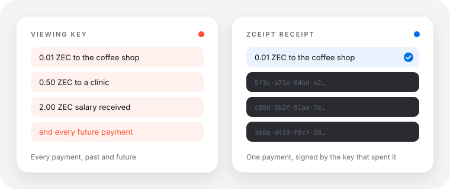

# Zceipt

**ZIP 311 for Orchard and Ironwood, extended so payments can be proven in relation to each other.**

Zceipt proves one Zcash payment without handing over a viewing key. It then goes further: it
proves facts about *sets* of payments (one payer, different payers, one wallet's accounts, a
delegated issuer, a total) without revealing the wallet's history.



## 1. Spend authority

ZIP 311 calls a payment disclosure complete only with a proof that the payer's spend authority
made the payment. For Orchard it says `TODO`. Zceipt fills that in for Orchard and Ironwood:
a fresh Orchard Action proof for the note the payment spent, and a signature by the key that
spent it. Opening a receipt shows who was paid, how much and the memo, and that the payer made it.
Change one character and it fails.

Output disclosure alone (what [zreceipt](docs/RELATED-WORK.md) and the ZIP 311 output-disclosure
draft do) can be made by anyone who saw the payment. The verifier page shows the difference:
the same payment claimed with another key reads **NOT PROVEN BY THE PAYER**.

## 2. Composability

On top of spend authority, each of these states one relationship and reveals nothing else about
the wallet:

| Question | Proof | Docs |
|---|---|---|
| Did one key make all of these payments? | Same-payer proof | [same payer](docs-site/composability/same-payer.mdx) |
| Did N different wallets pay, not one wallet N times? | Payer tags, claim tags | [distinct payers](docs-site/composability/distinct-payers.mdx) |
| Are these two payers accounts of one wallet? | Sibling-account proof | [sibling accounts](docs-site/composability/sibling-accounts.mdx) |
| Was it signed by one of a department's keys? | Key-set proof | [key sets](docs-site/composability/key-sets.mdx) |
| Can a back office issue receipts without my spend key? | Delegation | [delegation](docs-site/composability/delegation.mdx) |
| Did I receive at least X across payments, from k payers? | Income proof | [income](docs-site/composability/income.mdx) |
| Was it authorized by this 2-of-3 treasury? | FROST policy proof | [FROST policy](docs-site/composability/frost-policy.mdx) |
| Did the money come from this vetted set? | Source and screened-set proofs | [source of funds](docs-site/composability/source-of-funds.mdx) |

The design, in order, with why each piece is needed: [TECHNICAL-NOTE.md](TECHNICAL-NOTE.md).
The same material as a Mintlify site: [docs-site/](docs-site) (`cd docs-site && npx mint dev`).

## Status

- **Network:** Zcash public testnet and private regtest chains. Nothing has been run on mainnet.
- **Unaudited.** The construction has been reviewed only by its author
  ([CRYPTO-REVIEW.md](docs/CRYPTO-REVIEW.md), which found and fixed one forgery) and checked by a
  second verifier, mutation testing and fuzzing ([ASSURANCE.md](docs/ASSURANCE.md)).
- **The base receipt** uses the stock Orchard Action circuit and keys. Real testnet payments,
  verified in the CLI and the browser.
- **Two proofs use circuits written or forked here**, and nobody else has reviewed them:
  claim and payer tags (a fork of the Action circuit, `vendor/orchard/src/circuit/claim.rs`) and
  sibling-account proofs (a new Halo 2 circuit with a BLAKE2b gadget ported from
  `eryxcoop/blake2b_halo2`, whose authors say it is unaudited; the port is too). Both now run on
  the Zcash public testnet (`scripts/e2e-testnet.sh`) and have been attacked there and offline
  ([ASSURANCE.md](docs/ASSURANCE.md)); the attacks found and fixed five weaknesses around them.
- **Delegation, one-verifier receipts and FROST policy proofs** use no new circuit, and all three
  run on the testnet too (the FROST treasury is a testnet wallet's key split by a trusted dealer).
- **Runs on testnet:** every proof above, plus the base receipt, batches with same-payer proofs,
  key sets, income proofs, screened sets and source proofs. Real proofs: [examples/testnet/proofs](examples/testnet/proofs).
- Binaries here build on `orchard` 0.16 plus a patch ([vendor/README.md](vendor/README.md)); the base
  receipt builds on stock `orchard`.
- Sapling and transparent spends are out of scope: ZIP 311 already covers Sapling.

Per-proof evidence and caveats: [docs-site/status.mdx](docs-site/status.mdx). To report a problem:
[SECURITY.md](SECURITY.md).

## See it work (no Rust, no wallet)

```bash
./scripts/serve-verifier.sh        # then open http://127.0.0.1:5321
```

Click **Try a real testnet receipt**: a real 0.01 TAZ payment
([`571de6e4…`](https://testnet.cipherscan.app/tx/571de6e4cc96b64c0d849cc172905449011b195e521532d78fe9c29a149e0e73))
opens as the merchant it paid (`examples/testnet/merchant.ua`) and shows **PAID TO YOU**; opened
without your address, a receipt shows **VERIFIED · RECIPIENT NOT CHECKED**. Click **Try an
edited copy**: the same receipt with its signed message changed from "Order #42" to "Order #43"
shows **NOT VALID**. Click **Try a claim by someone who only saw it**: the same payment claimed
with another key shows **NOT PROVEN BY THE PAYER**, which is what an output-only disclosure can't
tell apart. **Make one with your own message** signs a real testnet payment from a public demo
wallet ([`examples/testnet/demo`](examples/testnet/demo)) for whatever you type, in the browser,
then verifies it (shown as the demo wallet, since its key is public); `zceipt demo -m "…"`
prints one to check with `zceipt verify`. The first check also loads the verifier (3 to 10 seconds).

<p>
</p>

**Check the cryptography with no Rust:** `python3 -m unittest discover -s spec-verifier/tests`
runs a second verifier written from the protocol specification. It checks everything but the
Halo 2 proofs and agrees with ours on all 278 conformance vectors (two are rejected only by the
Halo 2 check, so it flags those as needing it) and on 232 adversarial receipts.

**With Rust:** `cargo install --locked --path crates/zceipt-cli && zceipt demo` (about ten
minutes to build the first time).

## Make a receipt from your wallet

**No terminal:** the verifier's **Make a receipt** page (`make.html`) takes your wallet's
viewing key, the payment's txid and the wallet's birthday, finds the note and makes the proofs
in your browser (about a minute), then signs with your seed phrase on the same device or saves
the prepared receipt for another signer. Nothing leaves the device but block requests.

**In a wallet:** wallets on the Zcash Android or iOS SDK add the button with two calls from
the Swift/Kotlin bindings, `prepareReceipt(dbPath, …)` and `signPrepared(…)`
([crates/zceipt-ffi](crates/zceipt-ffi), [guide](docs/guides/wallet-integration.md)).

**In a terminal**, the CLI finds your notes by scanning the chain from the wallet's birthday:

| You have | Command |
|---|---|
| A viewing key (any wallet exports one) | `zceipt create --ufvk @key.txt --birthday <height> --txid <txid> --unsigned r.txt`: the proofs, with no spending key |
| Then, on a machine that holds the seed (offline is fine) | `zceipt sign r.txt --seed-stdin`: shows everything the receipt reveals and asks before signing |
| Or the seed phrase on one machine | `zceipt create --seed-stdin --network main --birthday <height> --txid <txid>` |
| A zcash-devtool wallet | `zceipt create -w <wallet> -i <key.age> --txid <txid>` |

The seed phrase is typed (not shown) or piped in, never put on the command line. `zceipt export` turns many receipts into a spreadsheet and keeps a
record of each check for a case file.

## What a receipt proves

| | Shown | How it is checked |
|---|---|---|
| Who was paid, how much, the memo | yes | Opened from the transaction on chain with a key that opens only that output |
| That it was signed by the key that spent the money | yes | A fresh zero-knowledge proof for the note the payment spent, and a signature over the whole receipt |
| A message (invoice number, a verifier's challenge) | yes | Signed with the receipt |
| The payer's address, balance, other payments | no | Never included |
| That the payment is on chain | on a chain server's word | `--cross-check <host:port>` asks a second server of your choice (it learns the txid) |

A link is about 7 KB; some chat apps cut long links, so the page also saves a receipt as a file
and opens one. The payer chooses which outputs to show, so a verifier checks the recipient it expects
(`--expect-address`, or the page's "Was it paid to you?"). Exact claim, assumptions and limits:
[CLAIM.md](docs/CLAIM.md).

## Who learns what

| Party | Learns | Doesn't learn |
|---|---|---|
| Whoever you give the receipt to | the shown outputs, your message, that you paid | your address (unless you choose to prove it), balance, other payments |
| The chain server, when someone verifies (by default ChainSafe's for the page, zec.rocks for the CLI, or yours) | the payment's block (or, if it is quiet, its run of 4 blocks) and up to 64 transactions in each; the verifier's IP | which of those transactions (the testnet sample's block has 5), or anything in the receipt |
| The chain server, when you make a receipt | the block range it scans | which note, payment or transaction |

In a quiet block the server can narrow it down, and the page and CLI say so. Full analysis:
[THREAT-MODEL.md](docs/THREAT-MODEL.md).

## Who needs it

- **Exchanges and bridges holding a shielded deposit.** In July 2026 a user's $589K from a
  shielded ZEC swap was held for 50+ days; they offered to "sign a verification message", and
  there was no Zcash-native way to do that ([forum](https://forum.zcashcommunity.com/t/my-experience-exiting-shielded-zec-from-zodl-to-near-intents-589k-usdt-still-held-50-days-despite-a-written-compliance-clearance/57497)).
  See [the held-deposit guide](docs/guides/held-deposit.md).
- **P2P trades and disputes.** An arbitrator checks one payment instead of asking for a viewing
  key ([guide](docs/guides/p2p-trades.md)).
- **Wallets.** Zodl's open issue for an authenticated reply-to address
  ([zodl-project#42](https://github.com/zodl-inc/zodl-project/issues/42)) needs a spend proof;
  a receipt supplies one.
- **Grant programs, payroll and DAOs** proving they paid everyone, and counting different
  donors, with one link.

## For developers and reviewers

```rust
let prepared = ReceiptBuilder::new(Network::Mainnet, &tx)      // a mined transaction
    .message(b"Invoice 42").disclose(1, ovk).spend(witness)    // proofs from the viewing key
    .prepare(&pk, &mut rng)?;
let sigs = sign_prepared(prepared.unsigned(), prepared.alphas(), &[ask], &mut rng)?;  // or on a signer
let receipt = prepared.apply_signatures(sigs)?;
let shown = verify_transaction(&vk, &receipt, Network::Mainnet.coin_type(), &tx)?;
```

- [docs/README.md](docs/README.md): which document to read for what.
- [DEVELOPERS.md](docs/DEVELOPERS.md): the Rust crate, signing on a separate device (the reference signer), bindings,
  everything beyond one payment, testnet evidence, and the repository layout.
- [ZIP311-ORCHARD.md](docs/ZIP311-ORCHARD.md): the proposed text for ZIP 311's Orchard `TODO`
  (also in ZIP form: [docs/zip/zip-0311-orchard-draft.rst](docs/zip/zip-0311-orchard-draft.rst)).
- [OPEN-QUESTIONS.md](docs/OPEN-QUESTIONS.md): where a reviewer starts, with the public questions
  about spend authority for Orchard answered, each with its test.
- `./scripts/check-all.sh` runs the checks that need no Rust build, given the prebuilt `zceipt` binary for the last three (about two minutes);
  `./scripts/test-all.sh` runs every suite, including the regtest chain end to end.

## Optional tooling

A payment API for shops (`zceipt shop`), SDKs for TypeScript, Python, Rust and Go, webhooks and a
dashboard sit around the same core. They are not part of the contribution; see
[docs/QUICKSTART.md](docs/QUICKSTART.md) and [docs/FEATURES.md](docs/FEATURES.md). Proof requests,
batches, incoming receipts, memo-withheld outputs and refunds are in
[DEVELOPERS.md](docs/DEVELOPERS.md#beyond-one-payment).

## Related work

Three other projects started on ZIP 311 output disclosure this autumn: zreceipt,
zcash-delivery-proof and auzum197's `zcash_disclosure`. They disclose outputs; zreceipt also has
a test prototype of a spend-authority proof. [RELATED-WORK.md](docs/RELATED-WORK.md) compares
them, and [COMPARISON.md](docs/COMPARISON.md) compares viewing-key payment processors.

Built for ZECATHON 2026, Core & Tooling track ([SUBMISSION.md](SUBMISSION.md)).

## License

MIT OR Apache-2.0, at your option ([LICENSE-MIT](LICENSE-MIT), [LICENSE-APACHE](LICENSE-APACHE)).
