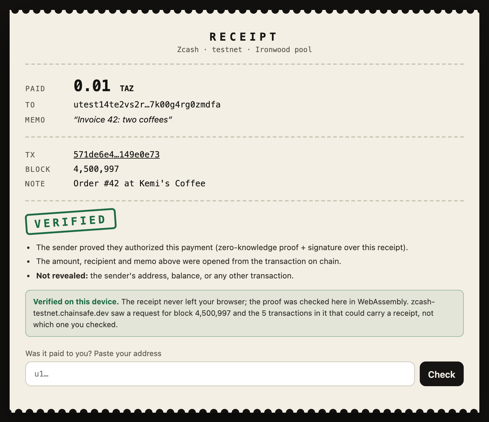
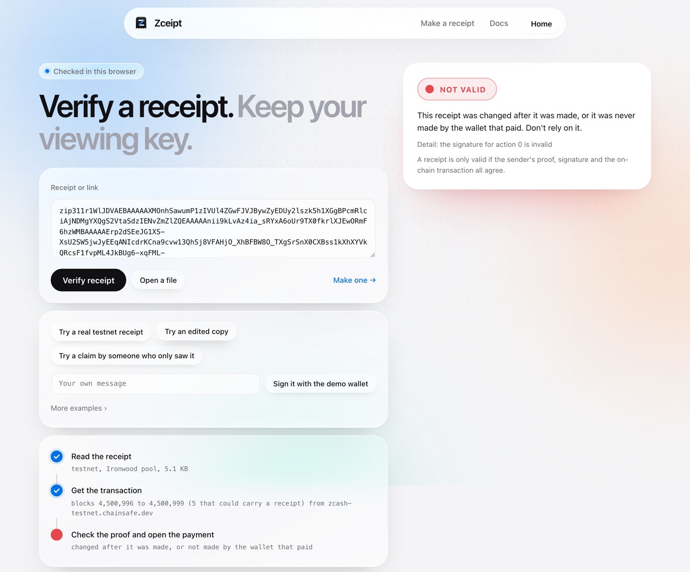

# Receipts

**ZIP 311 payment disclosures for Orchard and Ironwood: the wallet that paid proves one payment,
and nothing else about itself.**

Proving a shielded payment today means handing over a viewing key, which shows every payment
the wallet ever made or received. A receipt replaces the key. It shows one transaction's
recipient, amount and memo, and carries a zero-knowledge proof that the payer's spend authority
made the payment. It says nothing about the payer's address, balance or other transactions.

To our knowledge it is the first ZIP 311 implementation for Orchard and Ironwood that includes
the spend-authority proof: output-only disclosures ([related work](docs/RELATED-WORK.md)) show
what a transaction paid, which anyone holding a viewing key can do; a receipt shows the payer
made it.

Who needs this on Monday:
- **a customer in a dispute** ("I paid you on Tuesday") or a support desk checking a claim;
- **an exchange or compliance desk** asking where a shielded deposit came from;
- **a grant program, payroll or DAO** proving it paid everyone, without opening its treasury.

Built for ZECATHON 2026, Core & Tooling track. MIT or Apache-2.0.

## See it work (no Rust, no wallet)

```bash
./scripts/serve-verifier.sh        # then open http://127.0.0.1:5321
```

It serves the browser verifier from the committed WebAssembly build. Click **Try a real testnet
receipt**: a real payment ([`571de6e4…`](https://testnet.cipherscan.app/tx/571de6e4cc96b64c0d849cc172905449011b195e521532d78fe9c29a149e0e73),
0.01 TAZ, memo "Invoice 42: two coffees", signed note "Order #42 at Kemi's Coffee") shows
**VERIFIED**. Click **Try an edited copy**: the same receipt with its signed note changed to
"Order #43" shows **NOT VALID**. The first check also prepares the verifier, which takes 3 to 10
seconds depending on the machine; later checks take about a second.

<p>
</p>

A receipt is about 5 KB (a 7 KB link): almost all of it is the one Halo 2 proof per disclosed
spend, which is what proves who paid. That is too big for a QR code, so share it as a link, a
file or a message; it fits in a URL fragment. The receipt stays in the URL `#fragment`, which
browsers never send. The page fetches the payment
together with the other transactions in its block that could carry a receipt (up to 64; this
block has 5), so the chain server learns the block but not which of them was checked. In a quiet
block that hides little, and the page says how many there were.

**Check the cryptography in a minute**, with no Rust: `python3 -m unittest discover -s spec-verifier/tests`
runs an independent verifier written from the protocol specification, which checks everything but
the Halo 2 proofs and agrees with ours on all 270 conformance vectors and on a corpus of 232
receipts (192 with one byte flipped, 29 edited and re-signed or forged, 11 honest or hand-made; for the 9
that only the Halo 2 check tells apart it derives the same public inputs).

With Rust, `cargo install --locked --path crates/receipts-cli && receipts demo` verifies the same
real receipt and refuses the edited one, then tours the payment API on sandbox fixtures. The
first build takes about ten minutes; `docker compose run --build --rm receipts demo --no-wait`
works too.

## What a receipt proves

| | Revealed | How it is checked |
|---|---|---|
| Recipient, amount and memo of each chosen output | yes | The output's `ock` opens the on-chain ciphertext; the note commitment must equal the on-chain `cmx` |
| The holder of the spend authority used in the payment made this receipt | yes | A fresh Halo 2 Action proof for the spent note (same anchor, same nullifier as on chain, fresh `rk` and `cv_net`) and a spend-authorization signature over the whole receipt |
| A message (invoice number, verifier's challenge) | yes | Covered by the signature |
| Payer's address, balance, other notes and transactions | no | Never included |
| That the transaction was mined | on a lightwalletd server's word | The verifier fetches it from a lightwalletd server; `receipts verify --cross-check <server>` confirms the block with a second one |
| That the payee is someone else | no | The sender chooses which outputs to disclose (change discloses like any output); verifiers check the recipient they expect |

Output disclosure alone (an `ock`, or a note opening) can be made by anyone who saw the payment
with a viewing key. The spend proof is what makes it the payer's receipt: ZIP 311 calls a
disclosure complete only with it. Exact claim, assumptions and limits:
[CLAIM.md](docs/CLAIM.md). Construction: [SPEC.md](docs/SPEC.md).

## Who learns what

| Party | Learns | Doesn't learn |
|---|---|---|
| The person you give the receipt to | the disclosed outputs, your message, that you paid | your address (unless you add `--prove-address`), balance, other payments |
| The chain server, when someone verifies | one block, and a fetch of up to 64 of its transactions that could carry a receipt (links carry an `h=` block hint), or the txid without the hint; the verifier's IP | which of those transactions; anything in the receipt. On mainnet a receipt shares its block with about 4.6 such transactions on average and is alone about 10% of the time; the page and CLI say when the block is that quiet |
| The chain server, when you make a receipt | whole 1,000-block windows (only if your wallet pruned the note's witness) | which note or block |
| Anyone else | nothing | |

Opt-in features reveal more, and say so where they are used: `--prove-source` links your
deposit to the transaction that funded it, a proof of funds reveals the notes' nullifiers, and
a `refund-to:` line reveals the refund address. Full analysis: [THREAT-MODEL.md](docs/THREAT-MODEL.md).
What the server receives, recorded byte for byte: [ASSURANCE.md](docs/ASSURANCE.md#6-what-the-chain-server-sees).

## For wallet and protocol developers

The core is one Rust crate on top of `orchard` and `zcash_primitives`:

```rust
// The sender, after paying: disclose output 1, prove the spend in action 0.
let receipt = receipts_core::create(&pk, coin_type, Pool::Ironwood, txid, &bundle, b"Invoice 42",
    &[(1, ovk)], &[SpendWitness { index: 0, sk, note, merkle_path, prove_address: None, source: None }], rng)?;
let link = receipt.to_text(); // "zip311r1…"

// Anyone, with the mined transaction's bundle:
let v = receipts_core::verify(&vk, &Receipt::from_text(&link)?, coin_type, Pool::Ironwood, txid, &bundle)?;
```

- **Inside a wallet:** the proofs need only the full viewing key (`receipts_core::prepare`); the
  spend authorizing key signs afterwards, so the key can stay on a hardware wallet. The device is
  given the unsigned receipt and the randomizers, never a digest: it computes the digest itself,
  checks each `rk` against its key and shows what it signs (`receipts_core::sign_prepared` is the
  reference signer). A device that signed digests handed to it could be made to authorize a spend. The core builds on stock
  `orchard` 0.16 (`scripts/check-stock-orchard.sh`). `crates/receipts-wallet` makes receipts from
  a zcash-devtool wallet database, and `zcash-devtool wallet receipt --txid …` is a 137-line
  command on top of it ([integrations/zcash-devtool](integrations/zcash-devtool)).
- **The spec:** [ZIP311-ORCHARD.md](docs/ZIP311-ORCHARD.md) is the normative core (encoding,
  creation, every verification rule, rationale) written as text for ZIP 311's Orchard `TODO`;
  [SPEC.md](docs/SPEC.md) adds the extensions. [ZIP311-TODOS.md](docs/ZIP311-TODOS.md) maps each
  open item in ZIP 311 to what we chose, and [SPEC-AMBIGUITIES.md](docs/SPEC-AMBIGUITIES.md)
  lists where the specs are silent.
- **Conformance:** [270 vectors](conformance/README.md) from real Orchard and Ironwood receipts,
  run by the native and WebAssembly builds and the npm package.
- **A second verifier written from the protocol specification** in Python, with no shared code
  ([spec-verifier](spec-verifier)). It checks everything except the Halo 2 proof itself (it
  rebuilds the proof's public inputs), agrees on all 270 vectors and on 232 adversarial
  receipts (the 9 that only the Halo 2 check rejects get the same public inputs), and its
  primitives match the Zcash test vectors:
  `python3 -m unittest discover -s spec-verifier/tests`.
- **Assurance:** mutation testing, fuzzing of every decoder, Miri on the encoding, and a
  self-found forgery (address proofs trusted a prover-chosen value commitment), fixed, with the
  forged artifacts kept as must-fail vectors: [ASSURANCE.md](docs/ASSURANCE.md),
  [CRYPTO-REVIEW.md](docs/CRYPTO-REVIEW.md).
- **Bindings:** the browser verifier (WebAssembly, no server), an npm package and
  `<zcash-receipt>` web component, a CLI, and a REST API with SDKs for TypeScript, Python, Rust
  and Go.
- **A small patch to `orchard` 0.16** (about 60 lines, no circuit change) that this workspace
  applies for its own binaries, behind receipts-core's `orchard-ext` feature: precomputed
  verifier parameters (3x faster key building), incoming receipts and memo-withheld outputs. A
  crate that depends on receipts-core gets stock `orchard` and everything else
  ([vendor/README.md](vendor/README.md), `scripts/check-stock-orchard.sh`).

Sapling is out of scope: wallets now pay from Orchard and Ironwood, and ZIP 311 already
specifies Sapling.

## Status and upstream plan

The construction is unaudited: it has been reviewed only by its author ([CRYPTO-REVIEW.md](docs/CRYPTO-REVIEW.md),
which found and fixed one forgery), checked by a second verifier written from the protocol
specification, mutation testing and fuzzing ([ASSURANCE.md](docs/ASSURANCE.md)). The plan after
ZECATHON: propose [ZIP311-ORCHARD.md](docs/ZIP311-ORCHARD.md) as the text for ZIP 311's Orchard
item, offer receipts-core (which builds on stock `orchard`) to librustzcash, and get the
construction reviewed externally. [SECURITY.md](SECURITY.md) says how to report a problem.

## Beyond one payment

Each of these is built, tested, and proven on testnet or a regtest chain. Commands and evidence
are in [FEATURES.md](docs/FEATURES.md).

- **Proof requests:** a verifier's challenge is signed into the receipt, so an old receipt can't be replayed.
- **Batches:** one link for many payments, each signing its place, with a total that can't count a payment twice.
- **Sender address, optional:** `--prove-address` proves the payer also controls a public address.
- **Source of funds:** `--prove-source` proves which earlier output created each spent note, for exchanges that refuse shielded deposits today.
- **Memo withheld:** `--withhold-memo` proves recipient and amount and keeps the memo encrypted.
- **Incoming receipts:** the recipient proves it was paid, without an incoming viewing key.
- **Cross-pool:** Orchard spends paying Ironwood outputs, as wallets do after NU6.3.
- **Also:** signed payment requests, refunds, attestations, Sign in with Zcash, proof of funds, ZIP 320 TEX deposits, and an API with webhooks for shops.

## Related work

Three other projects started on ZIP 311 output disclosure this autumn: zreceipt,
zcash-delivery-proof and auzum197's `zcash_disclosure`. None of them proves who sent the
payment. [RELATED-WORK.md](docs/RELATED-WORK.md) compares them. Receipts' links start `zip311r1`; the
verifier recognises a zreceipt link (`zrcpt1…`) and says what it is. Next to viewing-key
payment processors: [COMPARISON.md](docs/COMPARISON.md).

## Evidence on the public testnet

| Claim | Evidence |
|---|---|
| A real Ironwood payment and its receipt | tx [`571de6e4…`](https://testnet.cipherscan.app/tx/571de6e4cc96b64c0d849cc172905449011b195e521532d78fe9c29a149e0e73), block 4,500,997; [examples/testnet/receipt.txt](examples/testnet/receipt.txt) |
| Verified by the CLI and in the browser | `receipts verify @examples/testnet/receipt-link.txt` → VALID in a few seconds, fetched by block (the link's `&h=`); the page → VERIFIED |
| An edited receipt is refused | [examples/testnet/receipt-edited.txt](examples/testnet/receipt-edited.txt) → `the signature for action 0 is invalid` |
| A challenge answered; a replayed receipt refused | [request-answer-link.txt](examples/testnet/request-answer-link.txt) → REQUEST SATISFIED; an older receipt → NOT SATISFIED |
| Sender address proven; another wallet's address refused | [receipt-with-sender-address.txt](examples/testnet/receipt-with-sender-address.txt) |
| A batch of three payments as one link | [examples/testnet/batch.txt](examples/testnet/batch.txt), total 0.022 ZEC |
| Source of funds, memo withheld, incoming receipt, signed request, refund, TEX deposit | [examples/testnet](examples/testnet) and its README |

`./scripts/check-all.sh` runs every check that needs no build, including the verifier page in headless Chrome, in about a minute.
`./scripts/e2e-regtest.sh` replays the whole story on a private Zebra regtest chain (needs
Docker, lightwalletd and zcash-devtool). Everything else runs with `cargo test --release`.

## Repository

| Path | What |
|---|---|
| `crates/receipts-core` | create and verify receipts; encoding; tests |
| `crates/receipts-chain` | lightwalletd access, on-chain verification, Merkle path rebuild |
| `crates/receipts-wallet` | receipts from a zcash-devtool wallet |
| `crates/receipts-cli` | the `receipts` command |
| `crates/receipts-wasm`, `web/` | the browser verifier |
| `crates/receipts-server`, `crates/receipts-client`, `packages/` | REST API and SDKs |
| `spec-verifier/` | the independent Python verifier |
| `conformance/` | shared test vectors |
| `docs/` | spec, claim, threat model, assurance, guides |
| `vendor/orchard` | `orchard` 0.16.0, plus the patch described in `vendor/README.md` |

## License

MIT OR Apache-2.0, at your option ([LICENSE-MIT](LICENSE-MIT), [LICENSE-APACHE](LICENSE-APACHE)).
